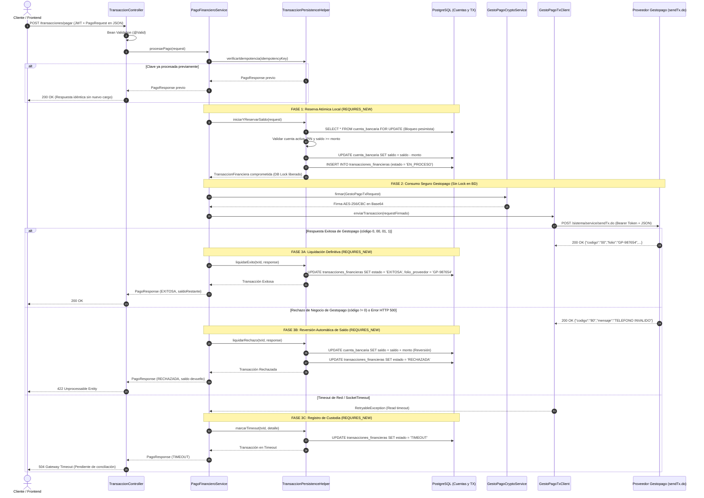
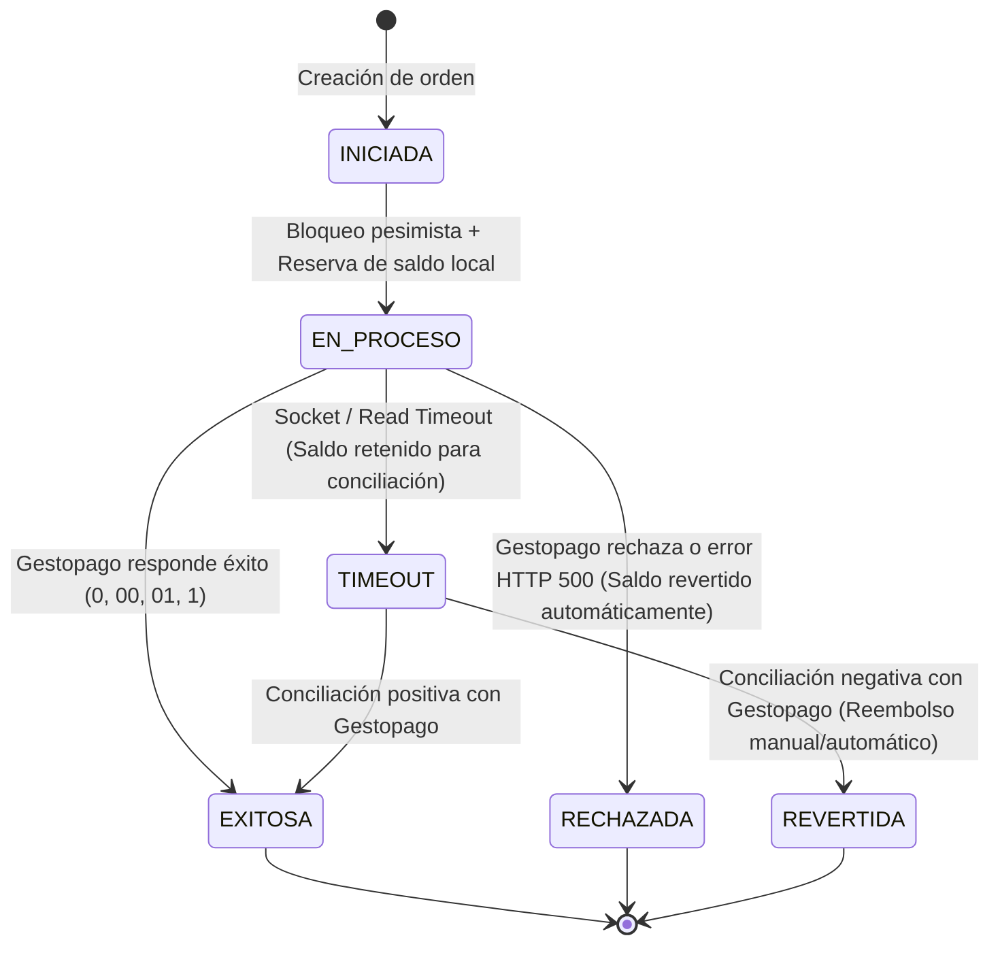
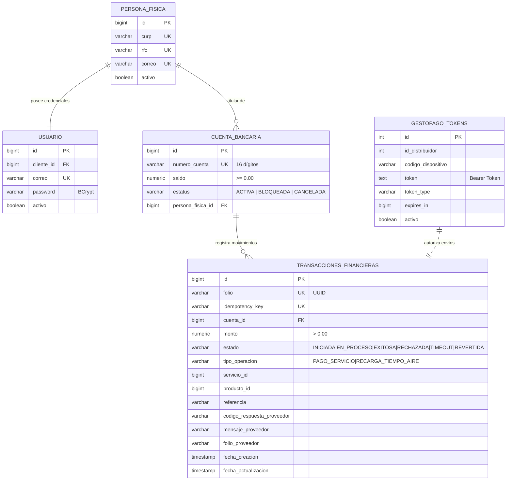

# Arquitectura y Manual Operativo: Integración Financiera Gestopago

Este documento constituye la referencia técnica, arquitectónica y operativa oficial para el módulo de procesamiento de pagos de servicios y recargas electrónicas integradas con el proveedor externo **Gestopago** (`POST /sistema/service/sendTx.do`).

---

## 1. Visión General y Principios de Diseño

El módulo bancario de transacciones financieras procesa operaciones en tiempo real garantizando:
1. **Contratos REST estrictos:** 100% de los endpoints reciben sus parámetros a través de `@RequestBody` mediante DTOs validados con Bean Validation (`@Valid`). Cero parámetros en URL (`@PathVariable` o `@RequestParam`).
2. **Prevención de doble gasto y consistencia ACID:** Desacoplamiento de transacción en dos fases con bloqueo pesimista `SELECT ... FOR UPDATE` a nivel de fila sobre la cuenta bancaria.
3. **Desacoplamiento de I/O externo y Base de Datos:** Las conexiones JDBC y los bloqueos a nivel de base de datos se liberan en milisegundos *antes* de iniciar la petición HTTP hacia Gestopago, previniendo el agotamiento del pool de conexiones ante latencia o caídas del proveedor.
4. **Idempotencia estricta:** Cada solicitud exige una clave única (`idempotency_key` con restricción `UNIQUE` en PostgreSQL). Reintentos de red devuelven el resultado previamente consolidado sin duplicar débitos.
5. **Cifrado criptográfico de nivel bancario:** Generación de firma digital por transacción mediante AES-256 en modo CBC con relleno PKCS5Padding y vector de inicialización de 16 bytes.

---

## 2. Diagramas de Arquitectura

### 2.1 Diagrama de Secuencia: Flujo Transaccional en Dos Fases



---

### 2.2 Diagrama de Máquina de Estados de la Transacción



---

### 2.3 Modelo de Datos Entidad-Relación (Persistencia Transaccional)



---

## 3. Matriz de Variables de Entorno

Todas las variables de configuración se gestionan mediante variables de entorno del sistema o archivos `.env`. Ninguna credencial ni clave criptográfica se encuentra embebida en el código fuente.

| Variable | Propósito | Formato / Ejemplo | Criticidad | Comportamiento por Defecto |
| :--- | :--- | :--- | :--- | :--- |
| `GESTOPAGO_TX_URL` | URL base del servicio de transacciones | `https://gestopago.portalventas.net` | **Alta** | `https://gestopago.portalventas.net` |
| `GESTOPAGO_TX_RUTA` | Endpoint para el procesamiento de transacciones | `/sistema/service/sendTx.do` | **Media** | `/sistema/service/sendTx.do` |
| `GESTOPAGO_AES_KEY` | Clave secreta para la firma criptográfica AES-256 | Cadena de texto secreta (al menos 16-32 chars) | **Crítica** | *Falla al iniciar si no está configurada en producción* |
| `GESTOPAGO_AES_IV` | Vector de inicialización (IV) para AES/CBC | Cadena de exactamente 16 caracteres ASCII | **Crítica** | `0123456789abcdef` |
| `GESTOPAGO_AES_TRANSFORMATION` | Algoritmo y modo de cifrado | `AES/CBC/PKCS5Padding` | **Media** | `AES/CBC/PKCS5Padding` |
| `GESTOPAGO_AUTH_URL` | URL base para renovación de tokens Bearer | `https://gestopago.portalventas.net` | **Alta** | `https://gestopago.portalventas.net` |
| `GESTOPAGO_AUTH_ID_DISTRIBUIDOR`| ID del distribuidor asignado por Gestopago | `83` | **Alta** | Sin valor por defecto |
| `GESTOPAGO_AUTH_CODIGO_DISPOSITIVO` | Código identificador del dispositivo/terminal | `POS-001-DEV` | **Alta** | Sin valor por defecto |
| `GESTOPAGO_AUTH_PASSWORD` | Contraseña del distribuidor ante Gestopago | Texto alfanumérico confidencial | **Crítica** | Sin valor por defecto |
| `GESTOPAGO_TX_TOKEN` | Token Bearer estático de respaldo (fallback) | Token JWT emitido por Gestopago | **Media** | Cadena vacía (se obtiene dinámicamente de PostgreSQL) |
| `JWT_SECRET` | Clave HMAC-SHA para los tokens de acceso del Core Bancario | Cadena segura de 256 bits (>=32 caracteres) | **Crítica** | Generar clave robusta |
| `SPRING_DATASOURCE_URL` | Cadena JDBC de PostgreSQL para datos bancarios | `jdbc:postgresql://host:5432/db_core` | **Crítica** | Configuración local |
| `FEIGN_LOGGER_LEVEL` | Nivel de logging HTTP para clientes Feign | `none` \| `basic` \| `headers` \| `full` | **Baja** | `basic` (nunca usar `full` en producción para proteger tokens y firmas) |

---

## 4. Guía de Operación, Soporte y Conciliación

### 4.1 Conciliación de Transacciones en Estado `TIMEOUT`

Una transacción en estado `TIMEOUT` indica que se debitó el saldo localmente y se envió la petición a Gestopago, pero la conexión se interrumpió antes de recibir confirmación (por latencia, congestión o socket timeout). **El saldo permanece bajo custodia bancaria** para proteger a la institución y al usuario de duplicidades.

#### Procedimiento de Conciliación:
1. **Identificación:**
   Ejecutar consulta de transacciones pendientes en base de datos:
   ```sql
   SELECT id, folio, idempotency_key, cuenta_id, monto, fecha_creacion
   FROM transacciones_financieras
   WHERE estado = 'TIMEOUT'
     AND fecha_creacion < NOW() - INTERVAL '10 minutes'
   ORDER BY fecha_creacion ASC;
   ```
2. **Cruce contra Gestopago:**
   Consultar el reporte o portal del distribuidor Gestopago con la fecha y hora de la transacción (`horaLocal`), la referencia y el monto.
3. **Resolución:**
   * **Caso A (La transacción SÍ pasó en Gestopago):**
     Consolidar el registro a `EXITOSA` registrando el folio de Gestopago:
     ```sql
     UPDATE transacciones_financieras
     SET estado = 'EXITOSA',
         codigo_respuesta_proveedor = '00',
         mensaje_proveedor = 'CONCILIADA MANUALMENTE CON FOLIO GESTOPAGO',
         folio_proveedor = 'GP-FOLIO-OBTENIDO',
         fecha_actualizacion = CURRENT_TIMESTAMP
     WHERE id = :idTransaccion AND estado = 'TIMEOUT';
     ```
   * **Caso B (La transacción NO pasó en Gestopago):**
     Revertir el saldo a la cuenta bancaria del cliente de forma atómica:
     ```sql
     BEGIN;
     UPDATE cuenta_bancaria
     SET saldo = saldo + :monto
     WHERE id = :cuentaId;

     UPDATE transacciones_financieras
     SET estado = 'REVERTIDA',
         codigo_respuesta_proveedor = 'CONCILIACION_REVERSA',
         mensaje_proveedor = 'REVERSADA POR NO EXISTIR REGISTRO EN GESTOPAGO',
         fecha_actualizacion = CURRENT_TIMESTAMP
     WHERE id = :idTransaccion AND estado = 'TIMEOUT';
     COMMIT;
     ```

---

### 4.2 Tabla de Interpretación de Códigos de Gestopago

| Código | Significado | Acción Automática del Core Bancario |
| :--- | :--- | :--- |
| `0`, `00`, `01`, `1` | **Transacción Exitosa** | Estado `EXITOSA`. El débito se confirma en la cuenta. Se retorna HTTP 200 con folio del proveedor. |
| `80` | Teléfono o cuenta destino inválida | Estado `RECHAZADA`. Saldo reembolsado al instante. Retorna HTTP 422. |
| `81` | Monto no admitido para el producto/servicio | Estado `RECHAZADA`. Saldo reembolsado al instante. Retorna HTTP 422. |
| `82` | Saldo insuficiente en la bolsa del distribuidor | Estado `RECHAZADA`. Saldo reembolsado. Alerta operativa a Tesorería. Retorna HTTP 422. |
| `90`, `99` | Error general del proveedor o sistema no disponible | Estado `RECHAZADA`. Saldo reembolsado. Retorna HTTP 422. |
| *Cualquier otro código* | Rechazo preventivo por código desconocido | Estado `RECHAZADA`. Saldo devuelto inmediatamente a la cuenta. |

---

### 4.3 Procedimiento de Rotación Segura de Credenciales

#### 1. Rotación de la Clave Criptográfica AES (`GESTOPAGO_AES_KEY`):
1. Coordinar con el equipo de soporte de Gestopago la nueva clave de cifrado compartida y la ventana de mantenimiento.
2. Actualizar la variable de entorno `GESTOPAGO_AES_KEY` en el gestor de secretos (ej. Render Environment Variables, AWS Secrets Manager o Vault).
3. Reiniciar la aplicación de forma controlada (`zero-downtime rolling restart`).
4. Ejecutar una transacción de prueba de recarga mínima (`POST /transacciones/pagar`) para comprobar la validez de la firma.

#### 2. Rotación de Contraseña del Distribuidor (`GESTOPAGO_AUTH_PASSWORD`):
1. Actualizar la variable `GESTOPAGO_AUTH_PASSWORD`.
2. Opcionalmente, invalidar los registros existentes en la tabla `gestopago_tokens` para forzar la reautenticación inmediata:
   ```sql
   UPDATE gestopago_tokens SET activo = FALSE;
   ```
3. El servicio `GestoPagoTokenServiceImpl` solicitará automáticamente un nuevo token Bearer en la siguiente petición o ciclo `@Scheduled`.

